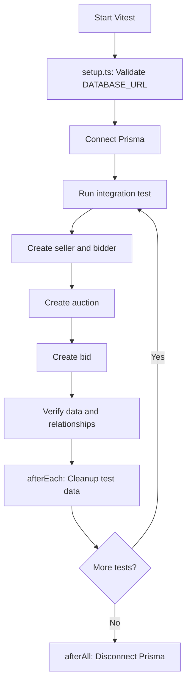
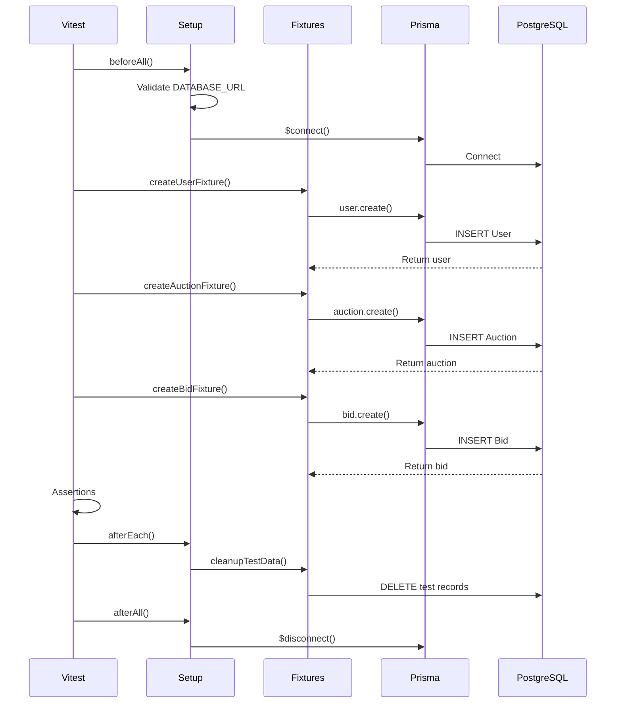

# Auction integration tests

Integration tests use the dedicated PostgreSQL service in
`docker-compose.test.yml`. They never use a duplicate Prisma schema.

From the repository root:

```sh
pnpm test:db:up
pnpm test:integration
pnpm test:db:down
```

The integration runner loads `packages/auction/.env.test` when present and
otherwise uses the disposable values in `.env.test.example`. Before applying
migrations, it rejects production mode, non-local hosts, ports other than
`55432`, and database names that do not end in `_test`.

`pnpm test:integration` runs `prisma migrate deploy` from `@snapbid/database`,
so the tests always use the package's existing schema and migration history.

## Overall Integration Test Flow



## Sequence Diagram


